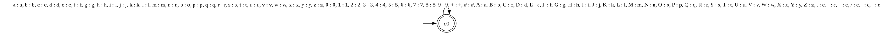
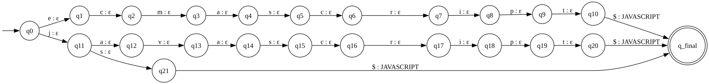
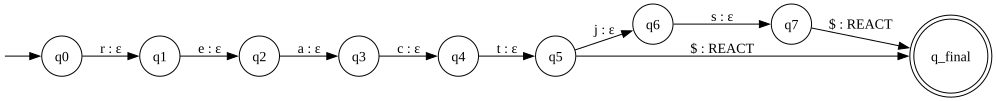
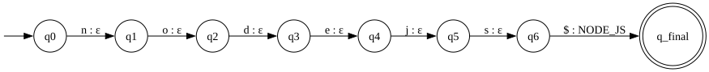
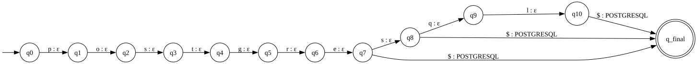
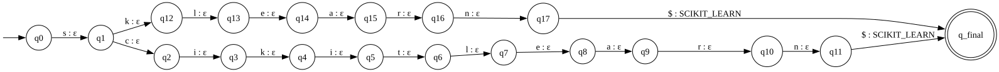
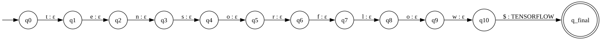
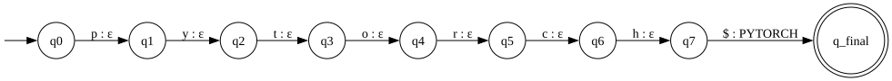

# Qualification Normalization with Finite-State Transducers

## 1. Overview and Problem Statement

The information extraction stage detects surface text segments representing candidate qualifications
(e.g., `JS`, `JavaScript`, `Node.js`, `scikit learn`, `Postgres`). However, downstream pattern recognition
with finite automata requires discrete symbols over a strictly defined, finite alphabet $\Sigma$.

Normalization transforms arbitrary surface variations into canonical qualifications
(e.g., `JAVASCRIPT`, `NODE_JS`, `SCIKIT_LEARN`, `POSTGRESQL`) through a fully formal approach:
a two-level cascade of Finite-State Transducers (FSTs) operating at the character level.

---

## 2. Formal 7-Tuple Definition of Transducers

In formal language theory, a finite-state transducer is defined as a 7-tuple:

$$T = (Q, \Sigma, \Gamma, \delta, \omega, q_0, F)$$

Where:
- $Q$ is a finite set of states.
- $\Sigma$ is the input alphabet.
- $\Gamma$ is the output alphabet.
- $\delta: Q \times \Sigma \to 2^Q$ is the state transition function.
- $\omega: Q \times \Sigma \to \Gamma^*$ is the output emission function.
- $q_0 \in Q$ is the initial state.
- $F \subseteq Q$ is the set of final (accepting) states.

### 2.1 Level 1: Cleaning Transducer ($T_{clean}$)

The cleaning transducer standardizes raw surface text by lower-casing letters and removing punctuation
separators. It is formalized as a single-state transducer:

* **$Q$**: $\{q_0\}$
* **$\Sigma$**: $\{a..z, A..Z, 0..9, +, \#, ., -, \_, /, \text{space}, \text{tab}\}$
* **$\Gamma$**: $\{a..z, 0..9, +, \#\}$
* **$q_0$**: $q_0$
* **$F$**: $\{q_0\}$
* **Transition and emission functions**:
  * $\forall c \in \{a..z, 0..9, +, \#\}: \delta(q_0, c) = q_0, \quad \omega(q_0, c) = c$
  * $\forall c \in \{A..Z\}: \delta(q_0, c) = q_0, \quad \omega(q_0, c) = \text{lower}(c)$
  * $\forall s \in \{., -, \_, /, \text{space}, \text{tab}\}: \delta(q_0, s) = q_0, \quad \omega(q_0, s) = \epsilon$

This transducer is mathematically equivalent to the `alias_key` comparison function.

---

### 2.2 Level 2: Lexicon Trie Transducers ($T_{lex}[g]$)

The second level maps cleaned character keys to their canonical qualification names.
To keep models structured and modular, qualifications are partitioned into five group transducers
matching the extraction skill categories:
`languages`, `frameworks`, `databases`, `tools`, and `other`.

Each group transducer is structured as a prefix tree (Trie):
* **$Q$**: Union of all trie node states $\{q_0, q_1, \dots, q_k\}$ plus an accepting state $q_{final}$.
* **$\Sigma$**: Characters present in the alias keys of the group, plus the end marker `$` ($\Sigma \subset \{a..z, 0..9, +, \#, \$\}$).
* **$\Gamma$**: The set of canonical qualification names for that group (e.g. `{"JAVASCRIPT", "TYPESCRIPT", ...}`).
* **$q_0$**: $q_0$ (trie root).
* **$F$**: $\{q_{final}\}$.
* **Transitions**:
  * Internal trie edges: $\delta(q_i, c) = q_j, \quad \omega(q_i, c) = \epsilon$ (characters are consumed silently).
  * Word termination: $\delta(q_{word\_end}, \$) = q_{final}, \quad \omega(q_{word\_end}, \$) = \text{CANONICAL}$.

#### Why Character-Level + End Marker `$`?
In text normalization, prefixes frequently overlap. For instance:
* `java` is a strict prefix of `javascript`.
* `git` is a strict prefix of `github` and `gitlab`.

Without an end marker, reaching the state for `java` would force a non-deterministic choice:
either emit `JAVA` immediately (failing if followed by `script`) or require lookahead.
By appending the delimiter `$`, reading `java$` unambiguously transitions to $q_{final}$ and emits `JAVA`,
whereas `javascript$` proceeds along the tree until its own `$` transition.

---

## 3. Two-Level Composition

In theoretical literature (Mohri, 1997; Roche & Schabes, 1997), cascading transducers can be formally
composed into a single transducer: $T = T_{clean} \circ T_{lex}$.

However, the pyformlang 1.0.11 implementation does not provide an automated composition operation for
nondeterministic FSTs. Therefore, ResumeLens executes the two levels in sequence:

$$\text{raw text} \xrightarrow{T_{clean}} \text{cleaned key} \xrightarrow{+ \$} \text{query} \xrightarrow{T_{lex}[g]} \text{canonical qualification}$$

If $T_{clean}$ encounters characters outside its alphabet, or if none of the five $T_{lex}$ transducers
recognizes the query, normalization returns `None`.

---

## 4. Focused Transition Diagrams

Focused diagrams illustrate the character-by-character recognition and prefix resolution for key technologies:

### 4.1 JavaScript (`JAVASCRIPT`)
Recognizes `js`, `javascript`, and `ecmascript`:

### 4.2 React (`REACT`)
Recognizes `react`, `reactjs`:

### 4.3 Node.js (`NODE_JS`)
Recognizes `nodejs`:

### 4.4 PostgreSQL (`POSTGRESQL`)
Recognizes `postgres`, `postgresql`, `postgre`:

### 4.5 Scikit-Learn (`SCIKIT_LEARN`)
Recognizes `sklearn`, `scikitlearn`:

### 4.6 TensorFlow (`TENSORFLOW`)
Recognizes `tensorflow`:

### 4.7 PyTorch (`PYTORCH`)
Recognizes `pytorch`:

---

## 5. Profile-Driven Canonical Sorting Policy

Different résumés list qualifications in arbitrary order. A candidate might list Git first and React last,
while another lists them in reverse.

To allow automata recognition without combinatorial state explosion, qualifications are sorted into the
canonical order dictated by each target profile before automata evaluation.

### Sorting Policy: $(category\_index, \text{original\_position})$
1. **Category Ordering:** Each professional profile defines an ordered sequence of categories $C_0, C_1, \dots, C_n$.
   Every qualification is assigned its category index: $cat\_idx = \text{profile.category\_index}(skill)$.
2. **Stable Occurrence Order:** When a candidate possesses multiple qualifications in the same category
   (e.g., `PANDAS` and `NUMPY` in Data Processing), their relative order of appearance in the résumé is preserved.
3. **Deduplication:** Duplicated qualifications are eliminated, keeping only the first occurrence.
4. **Handling of Irrelevant Skills (`ignored`):** Qualifications not required by the profile ($cat\_idx = \text{None}$)
   are routed to `ignored`. They are **never silently discarded**; the UI displays them clearly so users understand
   which skills were evaluated and which were ignored for each profile.

### Verification Case (from Task Statement)
* **Input Qualifications:** `GIT, NODE_JS, JAVASCRIPT, POSTGRESQL, REACT`
* **Target Profile:** `full_stack` (Categories: Frontend language $\to$ Frontend framework $\to$ Backend $\to$ Database $\to$ API $\to$ Version control)
* **Sorting Evaluation:**
  * `JAVASCRIPT` (Category 0: Frontend language)
  * `REACT` (Category 1: Frontend framework)
  * `NODE_JS` (Category 2: Backend)
  * `POSTGRESQL` (Category 3: Database)
  * `GIT` (Category 5: Version control)
* **Canonical Output Sequence:** `JAVASCRIPT, REACT, NODE_JS, POSTGRESQL, GIT`
* **Ignored:** `()`
