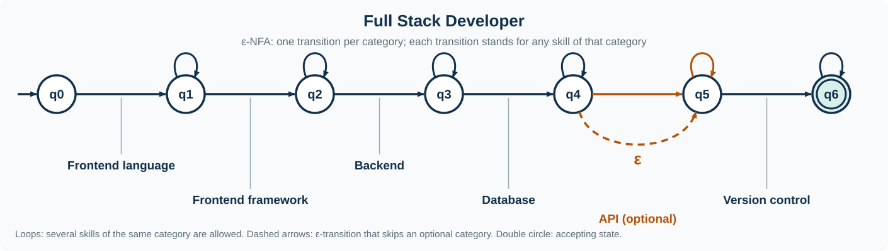
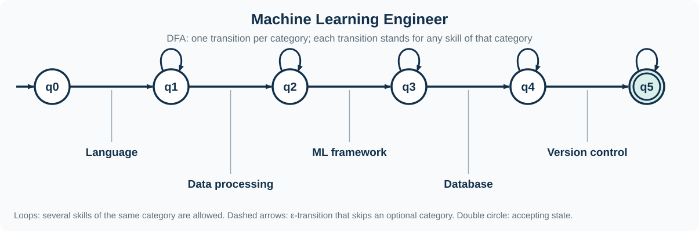
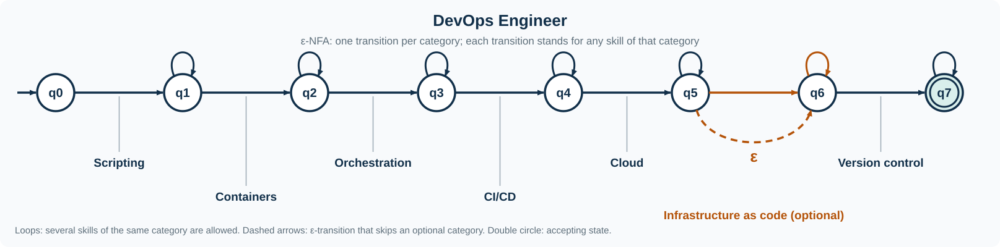
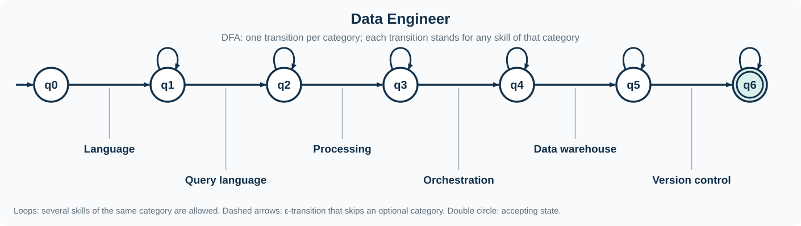

# Profile automata and classification

## Formal model

For a profile with ordered categories `C₁ … Cₙ`, the automaton has states
`Q = {q₀, q₁, …, qₙ}`, start state `q₀`, and accepting set `F = {qₙ}`. For
each qualification `s ∈ Cᵢ`, the transition function advances from `qᵢ₋₁`
to `qᵢ` and loops on `qᵢ`. Thus one or more qualifications can satisfy a
category, while multiple choices inside that category are alternatives.

An optional category adds `δ(qᵢ₋₁, ε) = qᵢ`. Full Stack has optional REST
API experience, and DevOps has optional infrastructure as code, so each is
an ε-NFA: its transition relation includes an epsilon transition. ML Engineer
and Data Engineer have no optional category. Their categories are disjoint,
so each input symbol has at most one destination from a state; these models
are DFAs. Their language expressions are respectively `C₁+ C₂+ … Cₙ+`,
with `Cᵢ` meaning the alternatives in that category; optional categories use
`Cᵢ*`.

The implementation builds a pyformlang automaton and an inspectable
five-tuple `(Q, Σ, δ, q₀, F)` for every profile. `simulate` independently
executes the tuple with epsilon closure. `infer_kind` derives the machine type
from epsilon edges and competing destinations.

## Classifier behavior

The classifier receives the already sorted canonical sequence and checks it
against every profile. It reports an accepted/rejected verdict, the consumed
state trace and any required category absent from the input. Results retain
profile declaration order. There is no score or candidate ranking, and one
candidate may satisfy more than one profile.

| Profile | Type | Category pattern |
|---|---|---|
| Full Stack Developer | ε-NFA | `(JAVASCRIPT \| TYPESCRIPT)+ (REACT \| ANGULAR \| VUE)+ (backend)+ (database)+ (REST_API)* (version_control)+` |
| Machine Learning Engineer | DFA | `(PYTHON)+ (PANDAS \| NUMPY)+ (ML_framework)+ (database)+ (version_control)+` |
| DevOps Engineer | ε-NFA | `(scripting)+ (DOCKER)+ (KUBERNETES)+ (CI_CD)+ (cloud)+ (TERRAFORM \| ANSIBLE)* (version_control)+` |
| Data Engineer | DFA | `(PYTHON)+ (query_language)+ (processing)+ (AIRFLOW)+ (warehouse)+ (version_control)+` |

The Streamlit recognition view generates a diagram from each transition table;
each category's choices share a transition label. The same five-tuple shown
beside the diagram is used by the independent simulator.

## Profile automaton diagrams

The diagrams below are generated from each profile's transition table. Blue
loops represent repeated qualifications within one category, dashed amber arrows
show optional epsilon transitions, and double circles mark accepting states.

### Full Stack Developer

### Machine Learning Engineer

### DevOps Engineer

### Data Engineer

